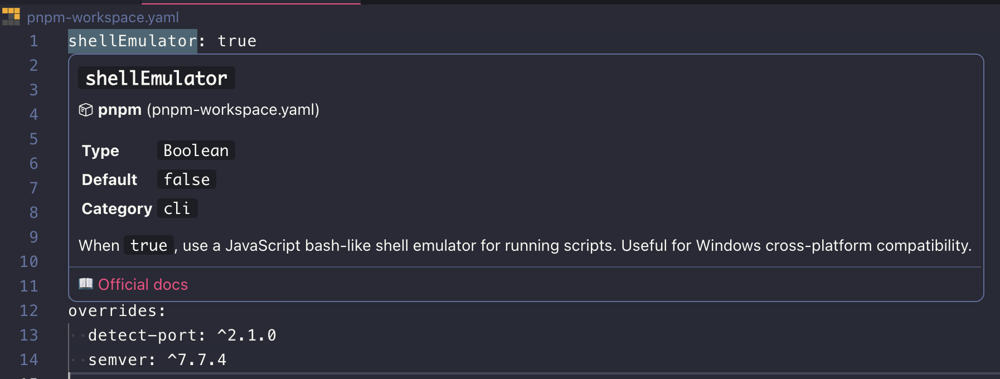

# npmrc Helper

[](https://marketplace.visualstudio.com/items?itemName=xlaoyu.npmrc-helper)
[](https://marketplace.visualstudio.com/items?itemName=xlaoyu.npmrc-helper)
[](https://github.com/Yuliang-Lee/npmrc-helper/actions/workflows/ci.yml)
[](LICENSE)

A VSCode extension that provides **IntelliSense** for package manager configuration files — hover documentation, auto-completion, and diagnostics — supporting:

- **`.npmrc`** — npm (v8 / v9 / v10 / v11) and pnpm (v10 / v11) **auth + registry only**
- **`pnpm-workspace.yaml`** — pnpm v11+ everything else (camelCase keys, catalogs, overrides, workspace fields, per-subproject `packageConfigs`)
- **`.yarnrc.yml`** — Yarn Berry (v2 / v3 / v4)

> **Why both `.npmrc` and `pnpm-workspace.yaml`?** Starting with **pnpm v11**, `.npmrc` is reduced to **auth + registry** (tokens, scoped registries, `always-auth`). Every other setting (`hoistPattern`, `nodeLinker`, `saveExact`, proxies, SSL, …) lives in `pnpm-workspace.yaml` using **camelCase** keys. Per-subproject overrides previously placed in nested `.npmrc` files now go under `packageConfigs["<project-name>"]`. See [pnpm settings](https://pnpm.io/settings), [pnpm-workspace.yaml](https://pnpm.io/pnpm-workspace_yaml), and [pnpm .npmrc](https://pnpm.io/npmrc).

---

## Features

### 🔍 Hover Documentation

Hover over any config key to see a rich popup with:

- **Type** and **default value**
- **Allowed values** (for enum-type keys)
- **Package manager badge** — `npm` or `pnpm` for `.npmrc`, `yarn berry` for `.yarnrc.yml`
- **Version badge** — `since vX` for keys added in newer versions, `removed in vX` for removed keys
- Full description
- Direct link to the official docs

### ✅ Auto-completion

**`.npmrc`**
- **Key completion**: Start typing to get suggestions filtered to the active package manager (npm or pnpm, auto-detected)
- **Value completion**: After `key=`, suggestions for keys with a fixed set of valid values (e.g. `loglevel`, `access`, `audit-level`)
- Deprecated and removed keys appear at the bottom with a strikethrough

**`pnpm-workspace.yaml`**
- **Key completion**: All workspace fields (`packages`, `catalog`, `overrides`, `packageConfigs`, `allowBuilds`, …) plus all pnpm settings in **camelCase** (`nodeLinker`, `hoistPattern`, `autoInstallPeers`, `saveExact`, …)
- **Value completion**: After `key: `, suggestions for keys with a fixed set of valid values (e.g. `nodeLinker`, `packageImportMethod`, `resolutionMode`)

**`.yarnrc.yml`**
- **Key completion**: All Yarn Berry configuration keys with docs
- **Value completion**: After `key: `, suggestions for enum-type keys (e.g. `nodeLinker`, `pnpMode`, `cacheMigrationMode`)

### ⚠️ Diagnostics

**`.npmrc`**
- Unknown config keys → warning squiggle
- Keys removed in newer npm versions (e.g. `node-version`, `ci-name`) → warning + strikethrough
- Deprecated keys (e.g. `production`, `shrinkwrap`) → hint + strikethrough
- Values that don't match the allowed set → warning
- Lines missing `=` → warning
- Scoped entries (`@scope:registry=…`, `//host/:_authToken=…`) are correctly skipped

**`pnpm-workspace.yaml`**
- Unknown top-level keys → warning squiggle
- **Migration hints**: kebab-case keys (e.g. `node-linker`) are flagged with the camelCase replacement (`nodeLinker`)
- **`allowBuilds` migration**: `onlyBuiltDependencies`, `neverBuiltDependencies`, `ignoredBuiltDependencies`, `onlyBuiltDependenciesFile` are flagged with a hint to use `allowBuilds: { <pkg>: true | false }`
- Deprecated keys → hint + strikethrough
- Invalid enum values → warning
- Nested keys (e.g. `catalog` entries) are skipped — only top-level keys are validated

**`.yarnrc.yml`**
- Unknown config keys → warning squiggle
- Deprecated keys → hint + strikethrough
- Invalid enum values → warning

### 🤖 Auto-detection: npm vs pnpm

For `.npmrc` files, the extension automatically determines whether the project uses **npm** or **pnpm** by looking for `pnpm-lock.yaml` or `pnpm-workspace.yaml` in the directory tree. Completions and diagnostics are scoped accordingly.

In pnpm v11+ projects, `.npmrc` is reserved for **auth + registry** only (`_authToken`, `//registry.../:_authToken`, `@scope:registry`, `_auth`, `always-auth`, `registry`). Move everything else — including proxies and SSL — to **`pnpm-workspace.yaml`**.

### 📸 Preview — `pnpm-workspace.yaml`

Hover documentation, camelCase key completion, enum value suggestions, and migration diagnostics for kebab-case keys:



---

## Supported Configurations

### npm (v8 – v11)

All keys from the [npm config documentation](https://docs.npmjs.com/cli/v11/using-npm/config) across versions v8, v9, v10, and v11, including:

| Key | Type | Default | Notes |
|-----|------|---------|-------|
| `registry` | URL | `https://registry.npmjs.org/` | |
| `loglevel` | String | `notice` | |
| `audit-level` | String | `null` | |
| `install-strategy` | String | `hoisted` | Added in v10 |
| `sbom-format` | String | `null` | Added in v10 |
| `omit` | String | — | Added in v9 |
| `node-version` | semver | — | ⚠️ Removed in v9 |
| `ci-name` | String | — | ⚠️ Removed in v10 |
| `production` | Boolean | — | ⚠️ Deprecated → use `--omit=dev` |
| `shrinkwrap` | Boolean | — | ⚠️ Deprecated → use `--package-lock` |
| … | … | … | |

### pnpm (v10 / v11)

pnpm reads two files:

- **`.npmrc`** — **auth + registry only** (`registry`, `_auth`, `_authToken`, `always-auth`, `@scope:registry=…`, `//host/:_authToken=…`).
- **`pnpm-workspace.yaml`** — **everything else** (camelCase keys).

#### Workspace-only fields

| Key | Type | Notes |
|-----|------|-------|
| `packages` | String[] | Workspace package globs |
| `catalog` / `catalogs` | Object | Versioned catalogs (pnpm v9+) |
| `overrides` | Object | Force resolutions of any dep |
| `patchedDependencies` | Object | Managed by `pnpm patch` |
| `packageExtensions` | Object | Extend dep manifests |
| `peerDependencyRules` | Object | Suppress / allow peer warnings |
| `allowBuilds` | `Record<String, Boolean>` | **pnpm v11**: replaces `onlyBuiltDependencies`, `neverBuiltDependencies`, `ignoredBuiltDependencies`, `onlyBuiltDependenciesFile` |
| `packageConfigs` | Object | **pnpm v11**: per-subproject overrides (replaces nested `.npmrc` files) |
| `requiredScripts` | String[] | Scripts every workspace package must define |
| `auditConfig` | Object | `pnpm audit` ignore-list |

#### Selected camelCase settings (formerly kebab-case in `.npmrc`)

| Key | Type | Default | Notes |
|-----|------|---------|-------|
| `nodeLinker` | String | `isolated` | `isolated` / `hoisted` / `pnp` |
| `hoistPattern` / `publicHoistPattern` | String[] | — | |
| `shamefullyHoist` | Boolean | `false` | |
| `autoInstallPeers` | Boolean | `true` | |
| `preferFrozenLockfile` | Boolean | `true` | |
| `blockExoticSubdeps` | Boolean | `false` (v10) / `true` (v11) | |
| `useNodeVersion` | semver | `""` | |
| `saveExact` / `savePrefix` | — | — | |
| `httpsProxy` / `httpProxy` / `proxy` / `noproxy` | URL / String | — | Migrated from `.npmrc` |
| `strictSsl` / `ca` / `cafile` / `cert` / `key` | — | — | Migrated from `.npmrc` |
| … | … | … | |

#### Example

```yaml
# pnpm-workspace.yaml
packages:
  - "apps/*"
  - "packages/*"

nodeLinker: isolated
autoInstallPeers: true
saveExact: true

allowBuilds:
  esbuild: true
  "@swc/core": true
  canvas: false

packageConfigs:
  "@my-org/web":
    nodeLinker: hoisted
    publicHoistPattern:
      - "*types*"
```

```ini
# .npmrc — auth + registry only
registry=https://registry.npmjs.org/
//registry.npmjs.org/:_authToken=${NPM_TOKEN}
@my-org:registry=https://npm.pkg.github.com/
//npm.pkg.github.com/:_authToken=${GH_TOKEN}
```

### Yarn Berry (v2 / v3 / v4)

All keys from the [Yarn Berry yarnrc.yml docs](https://yarnpkg.com/configuration/yarnrc), including:

| Key | Type | Default | npm equivalent |
|-----|------|---------|---------------|
| `npmRegistryServer` | String | `https://registry.yarnpkg.com` | `registry` |
| `npmAuthToken` | String | — | `_authToken` |
| `nodeLinker` | String | `pnp` | — |
| `enableStrictSsl` | Boolean | `true` | `strict-ssl` |
| `httpsProxy` | String | — | `https-proxy` |
| `httpsCaFilePath` | path | — | `cafile` |
| `enableScripts` | Boolean | `true` | `ignore-scripts` |
| `enableGlobalCache` | Boolean | `true` | — |
| `enableImmutableInstalls` | Boolean | `false` | — |
| `defaultSemverRangePrefix` | String | `^` | `save-prefix` |
| … | … | … | |

---

## Getting Started

### Development

```bash
git clone <repo>
cd npmrc-helper
npm install
# Open in VSCode and press F5 to launch the Extension Development Host
```

### Build & Package

```bash
npm run compile        # compile TypeScript
npm run lint           # run ESLint
npm run package        # produce npmrc-helper-x.x.x.vsix
```

### Install from VSIX

```
Extensions panel → ··· → Install from VSIX…
```

---

## Requirements

- VSCode `^1.85.0`
- Node.js `^20`

## Extension Settings

This extension has no configurable settings at this time.

## License

MIT
